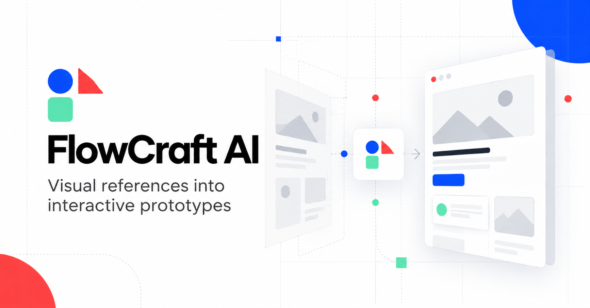

<h1>FlowCraft AI </h1>

> 从视觉参考与业务目标出发，生成可运行、可评测、可迭代的跨场景交互原型。

[](./frontend)
[](./backend)
[](./frontend)
[](./LICENSE)

**在线体验：** [flowcraft-ai-product.pages.dev](https://flowcraft-ai-product.pages.dev/)



## 项目简介

FlowCraft AI 是一个面向产品设计与原型验证的生成式 Agent 项目。用户上传参考页面并描述目标业务后，系统不会直接照搬原页面，而是提取其布局特征与设计规范，将其迁移到新的业务场景，并生成包含必要状态、交互反馈和异常恢复的可运行 HTML 原型。

项目重点解决三个问题：

- **视觉与业务冲突：** 参考 UI 只提供视觉语言，目标任务决定内容、流程与交互。
- **生成结果不可控：** 通过结构化 Spec 和任务优先级约束 Agent 的决策过程。
- **质量无法沉淀：** 将自动评测、人工验收、失败归因和历史回归串成迭代闭环。

## 核心能力

- 支持截图、图片组和短视频作为视觉参考
- 提供 Faithful、Balanced、Inspired 三档视觉迁移策略
- 围绕核心任务、必要状态和补充要求进行需求优先级决策
- 将参考页面的视觉结构映射到教育、SaaS 等不同业务场景
- 生成可运行 HTML，并提供桌面端与移动端预览
- 检查表单校验、加载、空状态、失败、成功与恢复路径
- 支持人工评分及 Good / Bad / Boundary Case 管理
- 对失败案例进行根因标注、修复对比与历史回归
- 持久化请求量、响应时间和异常日志，便于线上问题追踪

## Agent Pipeline

```text
视觉参考 + 业务 Brief
          │
          ▼
     视觉理解 Agent
  提取布局、层级与设计语言
          │
     Structured Spec
          │
          ▼
     业务决策 Agent
  决定任务流程、状态与语义映射
          │
          ▼
     原型生成 Agent
  生成并运行可交互 HTML
          │
          ▼
     评测与修复模块
  自动检查 + 人工验收 + 回归验证
```

结构化 Spec 作为各阶段的上下文协议，减少视觉分析、业务决策与代码生成之间的信息损失。发生冲突时，系统优先保障核心任务和必要交互状态，再考虑视觉参考与场景模板。

## 评测闭环

FlowCraft 不以“页面看起来相似”作为唯一标准，而是从结果、过程和工程稳定性三个层面评估生成质量：

| 层级 | 代表指标 |
| --- | --- |
| 结果质量 | 原型可运行率、核心任务完成率、人工验收结果 |
| 过程质量 | 必要状态覆盖、视觉语义一致性、修复前后评分变化 |
| 稳定性 | 请求成功率、响应时间、调用异常与质量回退 |

```text
生成 → 自动评测 → 人工确认 → Case 入库 → 失败归因
  ↑                                            ↓
回归验证 ← Prompt / Spec / Tool / 模型策略优化
```

Bad Case 可按需求解析、视觉理解、语义映射、代码生成和评测误判进行归因，并保留优化前后的评分与回归结果。

## 技术架构

- **Frontend:** React 18、TypeScript、Vite、Tailwind CSS
- **Backend:** FastAPI、Python、WebSocket / HTTP
- **Agent:** 结构化视觉解析、业务决策、代码生成、评测修复
- **Models:** DeepSeek，并保留 OpenAI、Anthropic、Gemini 等适配能力
- **Storage:** SQLite 持久化评测 Case 与监控数据
- **Deployment:** Cloudflare Pages 前端；Docker / Render 配置用于后端部署

## 本地运行

环境要求：Node.js、pnpm、Python 3.10+、Poetry。

```powershell
cd backend
poetry install

cd ..\frontend
pnpm install

cd ..
.\start-flowcraft.ps1 -NoBrowser
```

访问 `http://127.0.0.1:5173/`。模型 Key、完整环境变量和常见问题见 [本地配置文档](./docs/SETUP.md)。

Windows 下也可以运行 `start-flowcraft-online.cmd`，临时启动本机后端、创建 Cloudflare Tunnel，并更新线上前端的后端地址。该方式要求电脑保持开机联网，适合短期演示，不适合作为长期生产部署。

## 部署

- 前端已配置为由 GitHub `main` 分支自动部署至 Cloudflare Pages
- 后端提供 [Dockerfile](./backend/Dockerfile) 与 [render.yaml](./render.yaml)
- Render 免费部署说明见 [RENDER_DEPLOYMENT.md](./docs/RENDER_DEPLOYMENT.md)
- Koyeb 备选说明见 [KOYEB_DEPLOYMENT.md](./docs/KOYEB_DEPLOYMENT.md)

SQLite 适用于单实例和少量体验用户。若需要多实例扩容，应迁移至托管数据库，并为生成任务增加共享队列与统一限流。

## 项目结构

```text
FlowCraft-AI-Product/
├── frontend/     # 创建、预览、评测与 Case 管理界面
├── backend/      # Agent、模型调用、监控与持久化 API
├── docs/         # 配置、部署与产品设计文档
├── render.yaml   # Render 免费 Web Service 配置
└── start-flowcraft*.ps1 / .cmd
```

## 项目背景

FlowCraft AI 基于开源项目 [abi/screenshot-to-code](https://github.com/abi/screenshot-to-code) 的 MIT 代码基础开发。跨场景语义迁移、结构化 Agent Pipeline、任务优先级决策、分层评测、监控体系及 Good / Bad Case 回归闭环为 FlowCraft 的扩展能力。

## License

[MIT License](./LICENSE)
